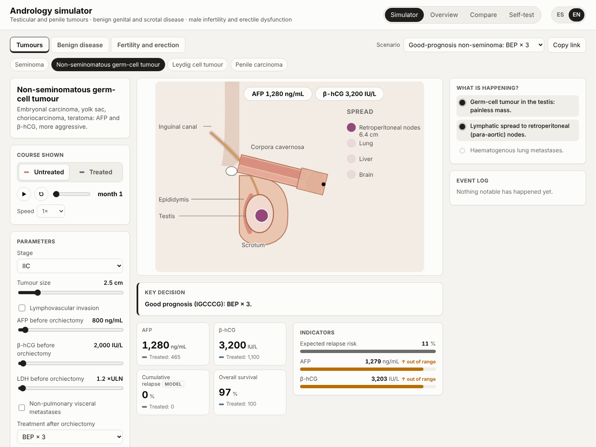

# Andrology simulator

**Testicular and penile tumours · benign genital and scrotal disease · male infertility and erectile dysfunction**

An interactive teaching simulator of andrology. Pick a scenario, change the stage, markers, timing, anatomy or cause, choose a treatment, and watch the course over hours, months or years on a live side-view diagram of the male genitalia (abdominal wall and inguinal canal, spermatic cord, testis and epididymis, scrotum, penis with corpora, glans, prepuce and meatus) with a context panel: spread, Doppler flow, the hypothalamic–pituitary–testicular axis or the erection pathway. The **untreated** course is shown by default; the **treated** course is one click away for comparison.

**Live demo:** https://ferasmed-dev.github.io/andrology-simulator/ · English: https://ferasmed-dev.github.io/andrology-simulator/?lang=en



> Teaching tool · not for clinical use.

## What it shows

13 simulations in three blocks, with 64 ready-made scenarios:

| Block | Simulations |
|---|---|
| **Tumours** | Seminoma and non-seminomatous germ-cell tumours (stage I–III, risk factors, AFP/β-hCG/LDH kinetics after orchiectomy, IGCCCG groups, surveillance, carboplatin, radiotherapy, BEP × 1/3/4, RPLND) · Leydig cell tumour (hormonal effects, testis-sparing surgery vs orchiectomy, malignant features) · penile squamous cell carcinoma (Tis–T4, organ-sparing vs amputation, nodal surveillance vs dynamic sentinel node biopsy vs radical inguinal dissection, neoadjuvant chemotherapy) |
| **Benign disease** | Acute scrotum (testicular torsion with degrees, hours to surgery and manual detorsion; appendix testis torsion; epididymo-orchitis by age) · cryptorchidism (position, bilaterality, age at orchidopexy; retractile testis) · varicocele (grade, adolescent asymmetry, semen, right-sided warning; microsurgery vs embolisation) · hydrocele (communicating, adult, secondary) · phimosis, paraphimosis and lichen sclerosus · Peyronie's disease (active vs stable phase; plication, grafting, prosthesis, traction) · hypospadias and epispadias |
| **Fertility and erection** | Male infertility (hypogonadotropic hypogonadism/Kallmann, Klinefelter, obstructive azoospermia, varicocele, anabolic steroids, normal male; partner's age; gonadotropins, micro-TESE, sperm retrieval, ICSI) · erectile dysfunction (vasculogenic, diabetic, after prostatectomy, psychogenic, hypogonadal; nitrates; lifestyle, PDE5 inhibitors, vacuum, alprostadil, testosterone, prosthesis) |

For each simulation: the **diagram** (tumour in the testis or on the glans, orchiectomy and its inguinal scar, retroperitoneal and inguinal nodes, twisted cord and ischaemia, empty scrotum and testis along its descent, dilated pampiniform plexus, hydrocele fluid, tight or retracted foreskin, lichen sclerosus, curvature and plaque, ectopic meatus, amputation, prosthesis; tumour markers, sperm concentration, curvature or IIEF-5 badges), **sliders and toggles**, **without vs with treatment** on one time axis, a **key decision** panel, **"What is happening?"** steps, an **event log**, **indicators**, **charts** or a **data table**, a **fact sheet** and **reference values**. Plus **Overview**, **Compare** (three simulations side by side) and **Self-test** (18 cases linked to scenarios). Spanish by default, English with the switch or `?lang=en`; light and dark mode; works on phones.

## Curriculum fit

Andrology is part of the clinical module (*Módulo III, Formación clínica humana*, Orden ECI/332/2008) in every Spanish medical degree, usually within **Urología** (*Patología médica y quirúrgica del aparato genitourinario*), with contributions from **Pediatría y Cirugía pediátrica** (cryptorchidism, hydrocele, phimosis, hypospadias, torsion), **Oncología médica** (germ-cell tumours), **Endocrinología** (hypogonadism, the gonadal axis) and **Anatomía patológica**. Acute scrotum, testicular tumours and their markers, cryptorchidism, varicocele and erectile dysfunction are recurrent MIR topics.

The simulator is topic-framed and faculty-neutral: students and teachers at any Spanish medical faculty can use it.

## For teachers

Every scenario has a link you can project or share; the table below lists all of them with what the model produces. Links open on the untreated course; press "Treated" to compare. Remove `&lang=en` for Spanish, and add `&autoplay=0` to start paused. Any custom set-up can be shared with the **Copy link** button.

## Presets: expected results

Values are the last time point of each run, untreated → treated (two charted variables). They are checked automatically in `tests/model.test.js`.

**Tumours**

| Preset (deep link) | Simulation | End of run: reference → compared course | Key events (with treatment) |
|---|---|---|---|
| [Stage I seminoma: surveillance](https://ferasmed-dev.github.io/andrology-simulator/?preset=seminomaStageISurveillance&lang=en) `seminomaStageISurveillance` | Seminoma (60 months) | Cumulative relapse 0 → 11.6 %; Overall survival 14.1 → 99.5 % | Radical inguinal orchiectomy; Markers back to normal after orchiectomy; Relapse in > 5% of the cohort |
| [Stage I seminoma, 5 cm with rete testis: carboplatin](https://ferasmed-dev.github.io/andrology-simulator/?preset=seminomaStageIRiskCarboplatin&lang=en) `seminomaStageIRiskCarboplatin` | Seminoma (60 months) | Cumulative relapse 0 → 8.7 %; Overall survival 14.1 → 99.6 % | Radical inguinal orchiectomy; Markers back to normal after orchiectomy; Relapse in > 5% of the cohort |
| [Seminoma IIA: radiotherapy](https://ferasmed-dev.github.io/andrology-simulator/?preset=seminomaIIARadiotherapy&lang=en) `seminomaIIARadiotherapy` | Seminoma (60 months) | Cumulative relapse 0 → 4.8 %; Overall survival 4.4 → 99.6 % | Radical inguinal orchiectomy; Chest–abdomen–pelvis CT: metastatic disease; Markers do not normalise after orchiectomy: there is distant disease; Para-aortic field (± ipsilateral iliac) |
| [Seminoma III: BEP × 3](https://ferasmed-dev.github.io/andrology-simulator/?preset=seminomaAdvancedBep&lang=en) `seminomaAdvancedBep` | Seminoma (60 months) | Cumulative relapse 0 → 10.6 %; Overall survival 0 → 95.5 % | Radical inguinal orchiectomy; Chest–abdomen–pelvis CT: metastatic disease; Markers do not normalise after orchiectomy: there is distant disease; Sperm cryopreservation before chemotherapy |
| [Stage I seminoma treated with BEP × 3](https://ferasmed-dev.github.io/andrology-simulator/?preset=seminomaStageIOvertreated&lang=en) `seminomaStageIOvertreated` | Seminoma (60 months) | Cumulative relapse 0 → 0.3 %; Overall survival 14.1 → 100 % | Radical inguinal orchiectomy; Markers back to normal after orchiectomy; Overtreatment: more toxicity without survival benefit; Sperm cryopreservation before chemotherapy |
| [Stage I non-seminoma: surveillance](https://ferasmed-dev.github.io/andrology-simulator/?preset=nsgctStageISurveillance&lang=en) `nsgctStageISurveillance` | Non-seminomatous germ-cell tumour (60 months) | Cumulative relapse 0 → 15 %; Overall survival 1.5 → 99.3 % | Radical inguinal orchiectomy; Markers back to normal after orchiectomy; Relapse in > 5% of the cohort |
| [Stage I non-seminoma with LVI: BEP × 1](https://ferasmed-dev.github.io/andrology-simulator/?preset=nsgctStageILviBep1&lang=en) `nsgctStageILviBep1` | Non-seminomatous germ-cell tumour (60 months) | Cumulative relapse 0 → 3 %; Overall survival 1.5 → 99.9 % | Radical inguinal orchiectomy; Markers back to normal after orchiectomy; Sperm cryopreservation before chemotherapy |
| [LVI on surveillance](https://ferasmed-dev.github.io/andrology-simulator/?preset=nsgctLviSurveillance&lang=en) `nsgctLviSurveillance` | Non-seminomatous germ-cell tumour (60 months) | Cumulative relapse 0 → 49.8 %; Overall survival 1.5 → 97.6 % | Radical inguinal orchiectomy; Markers back to normal after orchiectomy; Relapse in > 5% of the cohort |
| [Good-prognosis non-seminoma: BEP × 3](https://ferasmed-dev.github.io/andrology-simulator/?preset=nsgctGoodRiskBep3&lang=en) `nsgctGoodRiskBep3` | Non-seminomatous germ-cell tumour (60 months) | Cumulative relapse 0 → 11 %; Overall survival 0 → 96.1 % | Radical inguinal orchiectomy; Chest–abdomen–pelvis CT: metastatic disease; Markers do not normalise after orchiectomy: there is distant disease; Sperm cryopreservation before chemotherapy |
| [Poor-prognosis non-seminoma: BEP × 4](https://ferasmed-dev.github.io/andrology-simulator/?preset=nsgctPoorRiskBep4&lang=en) `nsgctPoorRiskBep4` | Non-seminomatous germ-cell tumour (60 months) | Cumulative relapse 0 → 45.9 %; Overall survival 0 → 68.2 % | Radical inguinal orchiectomy; Chest–abdomen–pelvis CT: metastatic disease; Markers do not normalise after orchiectomy: there is distant disease; Sperm cryopreservation before chemotherapy |
| [Poor prognosis treated with BEP × 3](https://ferasmed-dev.github.io/andrology-simulator/?preset=nsgctPoorRiskBep3&lang=en) `nsgctPoorRiskBep3` | Non-seminomatous germ-cell tumour (60 months) | Cumulative relapse 0 → 53.9 %; Overall survival 0 → 62.6 % | Radical inguinal orchiectomy; Chest–abdomen–pelvis CT: metastatic disease; Markers do not normalise after orchiectomy: there is distant disease; Treatment insufficient for this stage or prognostic group |
| [1.5 cm Leydig tumour: testis-sparing surgery](https://ferasmed-dev.github.io/andrology-simulator/?preset=leydigSmallSparing&lang=en) `leydigSmallSparing` | Leydig cell tumour (60 months) | Oestradiol 155 → 25 pg/mL; Hormonal effect (gynaecomastia or precocious puberty) 93 → 5 % | Testis-sparing surgery |
| [6 cm Leydig tumour with malignant features](https://ferasmed-dev.github.io/andrology-simulator/?preset=leydigMalignantOrchiectomy&lang=en) `leydigMalignantOrchiectomy` | Leydig cell tumour (60 months) | Oestradiol 222 → 25 pg/mL; Hormonal effect (gynaecomastia or precocious puberty) 95 → 5 % | Radical inguinal orchiectomy; Risk of malignancy: close CT follow-up |
| [Leydig tumour in a child: precocious puberty](https://ferasmed-dev.github.io/andrology-simulator/?preset=leydigChild&lang=en) `leydigChild` | Leydig cell tumour (60 months) | Oestradiol 147 → 25 pg/mL; Hormonal effect (gynaecomastia or precocious puberty) 91.2 → 5 % | Testis-sparing surgery |
| [Penile T1a G1: organ-sparing](https://ferasmed-dev.github.io/andrology-simulator/?preset=penileT1aSparing&lang=en) `penileT1aSparing` | Penile carcinoma (10 years) | Active nodal disease 92.5 → 0 %; Cumulative local recurrence 0 → 12 % | Organ-sparing treatment of the primary tumour; Nodal surveillance; Nodes appear on surveillance: late treatment |
| [Penile T2 cN0: sentinel node](https://ferasmed-dev.github.io/andrology-simulator/?preset=penileT2Dsnb&lang=en) `penileT2Dsnb` | Penile carcinoma (10 years) | Active nodal disease 95.5 → 0 %; Cumulative local recurrence 0 → 4 % | Partial amputation of the primary tumour; Dynamic sentinel node biopsy: stages micrometastases |
| [Penile T2 cN0 on nodal surveillance](https://ferasmed-dev.github.io/andrology-simulator/?preset=penileT2NodalSurveillance&lang=en) `penileT2NodalSurveillance` | Penile carcinoma (10 years) | Active nodal disease 95.5 → 0 %; Cumulative local recurrence 0 → 4 % | Partial amputation of the primary tumour; Nodal surveillance; Surveillance of an intermediate- or high-risk tumour: not recommended; Nodes appear on surveillance: late treatment |
| [Penile T2 with organ-sparing treatment](https://ferasmed-dev.github.io/andrology-simulator/?preset=penileT2OrganSparingWrong&lang=en) `penileT2OrganSparingWrong` | Penile carcinoma (10 years) | Active nodal disease 95.5 → 0 %; Cumulative local recurrence 0 → 40 % | Organ-sparing treatment of the primary tumour; Primary treatment insufficient for this stage: high risk of local recurrence; Dynamic sentinel node biopsy: stages micrometastases |
| [Penile T3 cN2: dissection](https://ferasmed-dev.github.io/andrology-simulator/?preset=penileCn2Ilnd&lang=en) `penileCn2Ilnd` | Penile carcinoma (10 years) | Active nodal disease 100 → 0 %; Cumulative local recurrence 0 → 4 % | Partial amputation of the primary tumour; Pelvic lymph node dissection; Risk of lymphoedema and wound complications |
| [Penile T4 cN3: total amputation](https://ferasmed-dev.github.io/andrology-simulator/?preset=penileT4Total&lang=en) `penileT4Total` | Penile carcinoma (10 years) | Active nodal disease 100 → 0 %; Cumulative local recurrence 0 → 4 % | Total amputation of the primary tumour; Perineal urethrostomy; Neoadjuvant chemotherapy (TIP) before nodal surgery; Pelvic lymph node dissection |

**Benign disease**

| Preset (deep link) | Simulation | End of run: reference → compared course | Key events (with treatment) |
|---|---|---|---|
| [Torsion operated at 5 h](https://ferasmed-dev.github.io/andrology-simulator/?preset=torsionEarly&lang=en) `torsionEarly` | Acute scrotum (48 h) | Testicular perfusion 0 → 105 %; Testis viable 0 → 95.1 % | Exploration: testis viable (95%), detorsion and orchidopexy; Fixation of the contralateral testis |
| [Torsion operated at 18 h](https://ferasmed-dev.github.io/andrology-simulator/?preset=torsionLate&lang=en) `torsionLate` | Acute scrotum (48 h) | Testicular perfusion 0 → 0 %; Testis viable 0 → 7.9 % | Half of testes can no longer be saved; Testicular necrosis; Late exploration: testis not viable (8%), orchiectomy; Fixation of the contralateral testis |
| [Manual detorsion and surgery at 10 h](https://ferasmed-dev.github.io/andrology-simulator/?preset=torsionManualDetorsion&lang=en) `torsionManualDetorsion` | Acute scrotum (48 h) | Testicular perfusion 0 → 107 %; Testis viable 0 → 97.2 % | Manual detorsion (rotate outwards, "open the book"): temporising; Exploration: testis viable (97%), detorsion and orchidopexy; Fixation of the contralateral testis |
| [Neonatal torsion](https://ferasmed-dev.github.io/andrology-simulator/?preset=torsionNeonatal&lang=en) `torsionNeonatal` | Acute scrotum (48 h) | Testicular perfusion 48.6 → 99.2 %; Testis viable 0 → 89.2 % | Exploration: testis viable (89%), detorsion and orchidopexy; Fixation of the contralateral testis |
| [Appendix testis torsion](https://ferasmed-dev.github.io/andrology-simulator/?preset=appendixTorsion&lang=en) `appendixTorsion` | Acute scrotum (48 h) | Testicular perfusion 100 → 100 %; Testis viable 100 → 100 % | Blue dot at the upper pole; Rest and anti-inflammatories |
| [Epididymo-orchitis at 24](https://ferasmed-dev.github.io/andrology-simulator/?preset=epididymitisYoung&lang=en) `epididymitisYoung` | Acute scrotum (48 h) | Testicular perfusion 168 → 115 %; Testis viable 100 → 100 % | Doppler: hyperaemia; Ceftriaxone + doxycycline (sexually transmitted pathogens) |
| [Epididymo-orchitis at 58](https://ferasmed-dev.github.io/andrology-simulator/?preset=epididymitisOlder&lang=en) `epididymitisOlder` | Acute scrotum (48 h) | Testicular perfusion 168 → 115 %; Testis viable 100 → 100 % | Doppler: hyperaemia; Quinolone (enteric organisms) |
| [Cryptorchidism: orchidopexy at 1 year](https://ferasmed-dev.github.io/andrology-simulator/?preset=cryptorchidismEarly&lang=en) `cryptorchidismEarly` | Cryptorchidism (30 years) | Germ cells (vs normal) 7.2 → 85.1 %; Testicular volume 7.2 → 16.3 mL | Inguinal orchidopexy |
| [Cryptorchidism: orchidopexy at 9 years](https://ferasmed-dev.github.io/andrology-simulator/?preset=cryptorchidismLate&lang=en) `cryptorchidismLate` | Cryptorchidism (30 years) | Germ cells (vs normal) 7.2 → 43.2 %; Testicular volume 7.2 → 11.4 mL | Half of the germ cells have been lost; Inguinal orchidopexy; Orchidopexy after 18 months: germ-cell damage already established |
| [Intra-abdominal testis](https://ferasmed-dev.github.io/andrology-simulator/?preset=cryptorchidismAbdominal&lang=en) `cryptorchidismAbdominal` | Cryptorchidism (30 years) | Germ cells (vs normal) 0.9 → 84 %; Testicular volume 6.4 → 16.2 mL | Laparoscopy and orchidopexy (Fowler-Stephens) |
| [Bilateral cryptorchidism](https://ferasmed-dev.github.io/andrology-simulator/?preset=cryptorchidismBilateral&lang=en) `cryptorchidismBilateral` | Cryptorchidism (30 years) | Germ cells (vs normal) 7.2 → 55.8 %; Testicular volume 7.2 → 12.9 mL | Inguinal orchidopexy; Orchidopexy after 18 months: germ-cell damage already established |
| [Retractile testis](https://ferasmed-dev.github.io/andrology-simulator/?preset=retractileTestis&lang=en) `retractileTestis` | Cryptorchidism (30 years) | Germ cells (vs normal) 100 → 100 %; Testicular volume 18.1 → 18.1 mL | Retractile testis: no surgery needed |
| [Grade 2 varicocele and infertility](https://ferasmed-dev.github.io/andrology-simulator/?preset=varicoceleInfertile&lang=en) `varicoceleInfertile` | Varicocele (36 months) | Sperm concentration 24.2 → 33.8 M/mL; Testicular volume asymmetry 8 → 8 % | Subinguinal microsurgical varicocelectomy; Semen improves (≈ 3 months, one cycle of spermatogenesis) |
| [Grade 3 varicocele in an adolescent](https://ferasmed-dev.github.io/andrology-simulator/?preset=varicoceleAdolescent&lang=en) `varicoceleAdolescent` | Varicocele (36 months) | Sperm concentration 26.3 → 33.9 M/mL; Testicular volume asymmetry 32 → 6.4 % | Subinguinal microsurgical varicocelectomy; Semen improves (≈ 3 months, one cycle of spermatogenesis) |
| [Subclinical varicocele](https://ferasmed-dev.github.io/andrology-simulator/?preset=varicoceleSubclinical&lang=en) `varicoceleSubclinical` | Varicocele (36 months) | Sperm concentration 36.1 → 36.1 M/mL; Testicular volume asymmetry 8 → 8 % | Subinguinal microsurgical varicocelectomy; Subclinical varicocele: no proven benefit |
| [Isolated right-sided varicocele](https://ferasmed-dev.github.io/andrology-simulator/?preset=varicoceleRight&lang=en) `varicoceleRight` | Varicocele (36 months) | Sperm concentration 24.2 → 33.8 M/mL; Testicular volume asymmetry 8 → 8 % | Isolated right-sided varicocele: exclude a retroperitoneal mass; Subinguinal microsurgical varicocelectomy; Semen improves (≈ 3 months, one cycle of spermatogenesis) |
| [Communicating hydrocele in an infant](https://ferasmed-dev.github.io/andrology-simulator/?preset=hydroceleInfant&lang=en) `hydroceleInfant` | Hydrocele (24 months) | Fluid volume 2.5 → 0 mL; Resolution 93.1 → 100 % | Ultrasound: normal testis; Persists at 12 months: closure of the processus vaginalis |
| [Adult hydrocele](https://ferasmed-dev.github.io/andrology-simulator/?preset=hydroceleAdult&lang=en) `hydroceleAdult` | Hydrocele (24 months) | Fluid volume 273 → 0 mL; Resolution 0 → 95 % | Ultrasound: normal testis; Hydrocelectomy |
| [Secondary hydrocele](https://ferasmed-dev.github.io/andrology-simulator/?preset=hydroceleSecondary&lang=en) `hydroceleSecondary` | Hydrocele (24 months) | Fluid volume 164 → 12 mL; Resolution 0 → 80 % | Ultrasound: underlying testicular lesion; The cause is treated |
| [Physiological phimosis at 4](https://ferasmed-dev.github.io/andrology-simulator/?preset=phimosisPhysiological&lang=en) `phimosisPhysiological` | Phimosis, paraphimosis and lichen sclerosus (24 months) | Foreskin retractable 40.5 → 88 %; Meatal stenosis 0 → 0 % | Topical steroid for 4–8 weeks |
| [Scarring phimosis at 9](https://ferasmed-dev.github.io/andrology-simulator/?preset=phimosisPathological&lang=en) `phimosisPathological` | Phimosis, paraphimosis and lichen sclerosus (24 months) | Foreskin retractable 3.1 → 100 %; Meatal stenosis 0 → 0 % | Circumcision |
| [Lichen sclerosus](https://ferasmed-dev.github.io/andrology-simulator/?preset=lichenSclerosus&lang=en) `lichenSclerosus` | Phimosis, paraphimosis and lichen sclerosus (24 months) | Foreskin retractable 3.1 → 100 %; Meatal stenosis 38.8 → 12 % | Circumcision; Histology of the foreskin |
| [Paraphimosis](https://ferasmed-dev.github.io/andrology-simulator/?preset=paraphimosis&lang=en) `paraphimosis` | Phimosis, paraphimosis and lichen sclerosus (24 months) | Foreskin retractable 3.1 → 50 %; Meatal stenosis 0 → 0 % | Paraphimosis after retracting the foreskin; Urgent manual reduction; Topical steroid for 4–8 weeks |
| [40° Peyronie’s: plication](https://ferasmed-dev.github.io/andrology-simulator/?preset=peyroniePlication&lang=en) `peyroniePlication` | Peyronie’s disease (30 months) | Curvature 48.3 → 5 °; Pain 0.3 → 0.3 /10 | Active phase: do not operate yet; Stable disease: surgery is now possible; Plication of the side opposite the plaque |
| [75° Peyronie’s: grafting](https://ferasmed-dev.github.io/andrology-simulator/?preset=peyronieSevereGraft&lang=en) `peyronieSevereGraft` | Peyronie’s disease (30 months) | Curvature 83.3 → 10 °; Pain 0.3 → 0.3 /10 | Active phase: do not operate yet; Curvature > 60°; Stable disease: surgery is now possible; Plaque incision and grafting |
| [Peyronie’s with erectile dysfunction: prosthesis](https://ferasmed-dev.github.io/andrology-simulator/?preset=peyronieWithEd&lang=en) `peyronieWithEd` | Peyronie’s disease (30 months) | Curvature 48.3 → 12 °; Pain 0.3 → 0.3 /10 | Active phase: do not operate yet; Stable disease: surgery is now possible; Penile prosthesis with modelling |
| [Distal hypospadias](https://ferasmed-dev.github.io/andrology-simulator/?preset=hypospadiasDistal&lang=en) `hypospadiasDistal` | Hypospadias and epispadias (18 years) | Function (standing voiding, straightness) 75 → 89.6 %; Cumulative complications 0 → 8 % | Do not circumcise: the foreskin is needed for the repair; Tubularised incised plate urethroplasty (TIP) |
| [Proximal hypospadias with curvature](https://ferasmed-dev.github.io/andrology-simulator/?preset=hypospadiasProximal&lang=en) `hypospadiasProximal` | Hypospadias and epispadias (18 years) | Function (standing voiding, straightness) 10 → 78.5 %; Cumulative complications 0 → 45 % | Do not circumcise: the foreskin is needed for the repair; Two-stage repair; Urethrocutaneous fistula or another complication |
| [Hypospadias with cryptorchidism](https://ferasmed-dev.github.io/andrology-simulator/?preset=hypospadiasDsd&lang=en) `hypospadiasDsd` | Hypospadias and epispadias (18 years) | Function (standing voiding, straightness) 25 → 80 %; Cumulative complications 0 → 40 % | Hypospadias with cryptorchidism: work-up for a disorder of sex development; Do not circumcise: the foreskin is needed for the repair; Two-stage repair; Urethrocutaneous fistula or another complication |
| [Epispadias](https://ferasmed-dev.github.io/andrology-simulator/?preset=epispadias&lang=en) `epispadias` | Hypospadias and epispadias (18 years) | Function (standing voiding, straightness) 35 → 83 %; Cumulative complications 0 → 30 % | Epispadias: exclude the bladder exstrophy–epispadias complex; Do not circumcise: the foreskin is needed for the repair; Epispadias repair; Urethrocutaneous fistula or another complication |

**Fertility and erection**

| Preset (deep link) | Simulation | End of run: reference → compared course | Key events (with treatment) |
|---|---|---|---|
| [Hypogonadotropic: hCG and FSH](https://ferasmed-dev.github.io/andrology-simulator/?preset=hypogonadotropicGonadotropins&lang=en) `hypogonadotropicGonadotropins` | Male infertility (24 months) | Sperm concentration 0 → 11.7 M/mL; Cumulative pregnancy 0 → 23.7 % | Low FSH, LH and testosterone: hypogonadotropic hypogonadism; hCG: stimulates Leydig cells; FSH added for spermatogenesis; Sperm appear in the ejaculate |
| [Kallmann syndrome](https://ferasmed-dev.github.io/andrology-simulator/?preset=kallmann&lang=en) `kallmann` | Male infertility (24 months) | Sperm concentration 0 → 11.7 M/mL; Cumulative pregnancy 0 → 23.7 % | Anosmia: Kallmann syndrome; Low FSH, LH and testosterone: hypogonadotropic hypogonadism; hCG: stimulates Leydig cells; FSH added for spermatogenesis |
| [Klinefelter: micro-TESE](https://ferasmed-dev.github.io/andrology-simulator/?preset=klinefelterTese&lang=en) `klinefelterTese` | Male infertility (24 months) | Sperm concentration 0 → 0 M/mL; Cumulative pregnancy 0 → 46.7 % | Very high FSH and LH, small firm testes: karyotype 47,XXY; Micro-TESE: sperm found in ≈ 40–50%; Do not give testosterone before sperm retrieval; ICSI cycle 1 |
| [Obstructive azoospermia](https://ferasmed-dev.github.io/andrology-simulator/?preset=obstructiveAzoospermia&lang=en) `obstructiveAzoospermia` | Male infertility (24 months) | Sperm concentration 0 → 0 M/mL; Cumulative pregnancy 0 → 79.2 % | Azoospermia with normal hormones and testes: obstructive; Sperm retrieval from the epididymis or testis; CFTR mutation testing (partner included); ICSI cycle 1 |
| [Anabolic steroids](https://ferasmed-dev.github.io/andrology-simulator/?preset=anabolicSteroids&lang=en) `anabolicSteroids` | Male infertility (24 months) | Sperm concentration 1 → 39.4 M/mL; Cumulative pregnancy 1 → 74.3 % | Suppressed LH and FSH with high testosterone: anabolic steroids; Anabolic steroids stopped; Transient hypogonadism while the axis wakes up |
| [Oligozoospermia from varicocele](https://ferasmed-dev.github.io/andrology-simulator/?preset=varicoceleOligozoospermia&lang=en) `varicoceleOligozoospermia` | Male infertility (24 months) | Sperm concentration 11 → 20 M/mL; Cumulative pregnancy 43 → 64 % | Oligoasthenozoospermia with a clinical varicocele; Varicocelectomy |
| [Klinefelter with a 40-year-old partner](https://ferasmed-dev.github.io/andrology-simulator/?preset=olderPartner&lang=en) `olderPartner` | Male infertility (24 months) | Sperm concentration 0 → 0 M/mL; Cumulative pregnancy 0 → 22.4 % | Very high FSH and LH, small firm testes: karyotype 47,XXY; Micro-TESE: sperm found in ≈ 40–50%; Do not give testosterone before sperm retrieval; ICSI cycle 1 |
| [Vasculogenic ED: PDE5i](https://ferasmed-dev.github.io/andrology-simulator/?preset=edVasculogenicPde5&lang=en) `edVasculogenicPde5` | Erectile dysfunction (12 months) | IIEF-5 10.4 → 17.4 ; Satisfactory intercourse 22.7 → 69.3 % | Erectile dysfunction precedes cardiovascular disease: assess risk; On-demand PDE5 inhibitor |
| [Patient on nitrates: PDE5i](https://ferasmed-dev.github.io/andrology-simulator/?preset=edNitrates&lang=en) `edNitrates` | Erectile dysfunction (12 months) | IIEF-5 10.4 → 10.4 ; Satisfactory intercourse 22.7 → 22.7 % | Erectile dysfunction precedes cardiovascular disease: assess risk; On-demand PDE5 inhibitor; PDE5i with nitrates: contraindicated, not given |
| [Patient on nitrates: alprostadil](https://ferasmed-dev.github.io/andrology-simulator/?preset=edNitratesAlprostadil&lang=en) `edNitratesAlprostadil` | Erectile dysfunction (12 months) | IIEF-5 10.4 → 19.4 ; Satisfactory intercourse 22.7 → 82.7 % | Erectile dysfunction precedes cardiovascular disease: assess risk; Intracavernous alprostadil; Risk of priapism: titrate the dose |
| [Severe diabetic ED: prosthesis](https://ferasmed-dev.github.io/andrology-simulator/?preset=edDiabeticProsthesis&lang=en) `edDiabeticProsthesis` | Erectile dysfunction (12 months) | IIEF-5 5.9 → 22.9 ; Satisfactory intercourse 0 → 100 % | Erectile dysfunction precedes cardiovascular disease: assess risk; Penile prosthesis implanted; Third line: after failure of the others; IIEF-5 ≥ 22 |
| [After prostatectomy](https://ferasmed-dev.github.io/andrology-simulator/?preset=edPostProstatectomy&lang=en) `edPostProstatectomy` | Erectile dysfunction (12 months) | IIEF-5 8.4 → 12.4 ; Satisfactory intercourse 9.6 → 36.3 % | On-demand PDE5 inhibitor; After prostatectomy, PDE5i depend on preserved nerves |
| [Hypogonadism: testosterone](https://ferasmed-dev.github.io/andrology-simulator/?preset=edHypogonadal&lang=en) `edHypogonadal` | Erectile dysfunction (12 months) | IIEF-5 11 → 16 ; Satisfactory intercourse 26.7 → 59.7 % | Testosterone |
| [Psychogenic ED](https://ferasmed-dev.github.io/andrology-simulator/?preset=edPsychogenic&lang=en) `edPsychogenic` | Erectile dysfunction (12 months) | IIEF-5 13 → 21 ; Satisfactory intercourse 40 → 93.3 % | On-demand PDE5 inhibitor |

## How the model works

All runs are deterministic. The tumour simulations are cohort models (expected values); the benign and functional simulations follow a typical patient. Code: `src/model/tumours.js`, `src/model/benign.js`, `src/model/function.js`.

**Germ-cell tumours.** After radical inguinal orchiectomy the primary share of each marker decays with its half-life (AFP 6 days, β-hCG 2.5 days, LDH 3 days); the metastatic share persists until systemic treatment, so a plateau signals distant disease. The cohort is split into cured, occult relapse, active relapse and failing fractions:

```
relapse after treatment = stage I: P(relapse on surveillance) × factor(treatment)
                          stage II–III: 1 − PFS(IGCCCG group, treatment adequacy)
occult → relapse at rate ln2 / (12 months seminoma, 7 months non-seminoma)
relapse → cured with P(salvage) = (OS − PFS) / (1 − PFS) of the group (0.95 after stage I)
```

**Penile carcinoma.** Occult inguinal metastasis probability by T and grade (0.01 for Tis to 0.6 for T4, × 1.25 for G3); staging the nodes early cures 88 % of node-positive patients, nodes found late on surveillance 40 %, clinical nodes by cN (0.8, 0.6, 0.35).

**Torsion.** Viability after *h* hours of full ischaemia: `1 / (1 + exp((h − T50)/2.4))`, with `T50 = 12 h × √(720°/degrees)`; manual detorsion slows ischaemia to 25 %.

**Cryptorchidism.** Germ-cell index falls by 5–16 % per year outside the scrotum (by position) from the second year; tumour incidence from puberty is 6/100 000 per year × relative risk (2.5–6, about halved by prepubertal orchidopexy).

**Infertility.** Typical FSH, LH, testosterone, sperm concentration and volumes for each cause; treatments change them with the ~74-day lag of spermatogenesis. Monthly natural conception: `0.2 · (conc / (conc + 20))² × female-age factor`; ICSI cycles every 2 months, 8–42 % each by female age, × retrieval success (micro-TESE 45 %, obstructive 97 %).

**Erectile dysfunction.** IIEF-5 drifts by cause; each treatment adds a cause-specific gain (Model); PDE5 inhibitors give nothing with nitrates; a prosthesis restores ≈ 23.

### Main parameters and their basis

| Parameter | Value | Basis |
|---|---|---|
| Stage I relapse on surveillance | Seminoma 12 / 16 / 30 % (0, 1, 2 risk factors: > 4 cm, rete testis) · NSGCT 15 % (LVI−) / 50 % (LVI+) | EAU testicular cancer guideline and cited series |
| Relapse reduction | Carboplatin × 0.3 · RT × 0.25 · BEP × 1 × 0.06 · RPLND × 0.25 | Literature range (Model) |
| IGCCCG 5-year PFS/OS | Seminoma good 89/95 %, intermediate 79/88 % · NSGCT good 89/96 %, intermediate 75/89 %, poor 54/67 % | Gillessen et al. 2021 (IGCCCG update) |
| IGCCCG cut-offs | AFP 1000 / 10 000 ng/mL · β-hCG 5000 / 50 000 IU/L · LDH 1.5 / 10 × ULN · non-pulmonary visceral metastases | IGCCCG |
| Marker half-lives | AFP 5–7 days · β-hCG 1–3 days | Standard teaching |
| Leydig cell tumour malignancy | 5 % (small), 30 % (> 5 cm), 60 % (malignant features) | ≈ 10 % overall (Model) |
| Penile occult nodal risk | 1–60 % by T; × 1.25 G3; × 0.85 HPV | EAU–ASCO penile cancer guideline risk groups (Model) |
| Torsion salvage | ≈ 95 % at 5 h, 50 % at 12 h, < 10 % at 18–24 h (720°) | Literature range |
| Germ-cell loss outside the scrotum | 5 / 9 / 16 % per year (high scrotal / inguinal / abdominal) | Histological series (Model) |
| WHO 2021 semen limits | Volume 1.4 mL · concentration 16 M/mL · total motility 42 % · progressive 30 % · morphology 4 % | WHO laboratory manual, 6th ed. |
| Testosterone threshold | 12 nmol/L | EAU sexual and reproductive health guideline |
| Varicocele effect on concentration | × 0.97 / 0.85 / 0.65 / 0.5 by grade | Model |
| Peyronie's natural history | Active phase 12 months, progression ≈ 0.7°/month, then stable | Literature range (Model) |
| Hypospadias complications | Distal 8 % · midshaft 15 % · proximal 40 % (× 1.3 with curvature, max 45 %) | Literature range |

### Known simplifications

- Tumour and penile simulations show cohort averages; benign and functional ones show a typical patient.
- Marker curves combine the cohort's expected relapse markers with the typical patient's decay; teratoma and growing teratoma syndrome are not modelled.
- Torsion viability depends only on hours and degrees; intermittent torsion is not modelled.
- Infertility profiles are typical values; mixed causes and female factors other than age are not modelled.
- Erectile dysfunction responses are average IIEF-5 gains, not individual response probabilities.

## Layout

```
index.html
src/model.js              public API: entities, presets, key decisions, model tags
src/model/core.js         shared engine (run, runBoth, sanitize…)
src/model/onco.js         shared oncology helpers (Weibull)
src/model/tumours.js      germ-cell tumours, Leydig cell tumour, penile carcinoma
src/model/benign.js       acute scrotum, cryptorchidism, varicocele, hydrocele, phimosis, Peyronie's, hypospadias
src/model/function.js     male infertility, erectile dysfunction
src/i18n.js               Spanish + English strings, self-test questions
src/ui.js                 DOM, playback, views, deep links, window.__sim hook
src/schematic.js          SVG genital diagram and context panels
src/charts.js             dependency-free SVG charts
src/styles.css
tests/model.test.js       classifications, mechanisms and every preset
tests/i18n.test.js        every string the model can emit exists in both languages; diagrams render
curriculum.json
```

## Run locally

No build step and no dependencies.

```bash
python3 -m http.server 8000
# open http://localhost:8000
```

## Tests

```bash
npm test     # node --test (Node 18+)
```

The tests check every simulation in both arms (finite, bounded values; extremes of every slider; purity), IGCCCG groups and stage I risk factors, marker half-life kinetics, penile nodal risk and primary adequacy, torsion viability, germ-cell loss in cryptorchidism, the gonadal-axis profiles, PDE5 inhibitors with nitrates, every preset's expected behaviour, the completeness of both languages and that every diagram renders without missing text. GitHub Actions runs them on every push.

## Deploy (GitHub Pages)

1. Create an empty public repository named `andrology-simulator`.
2. Push these files to `main` (with `index.html` at the root).
3. Settings → Pages → Deploy from a branch → `main` / `(root)`.
4. After 1–2 minutes the site is live at https://ferasmed-dev.github.io/andrology-simulator/.

## References

- EAU Guidelines on Testicular Cancer; Penile Cancer (EAU–ASCO); Paediatric Urology; Sexual and Reproductive Health. European Association of Urology, current editions.
- Gillessen S, et al. Predicting outcomes in men with metastatic nonseminomatous germ cell tumors: an update of the IGCCCG classification. J Clin Oncol. 2021;39:1563–74; Beyer J, et al. Seminoma update. J Clin Oncol. 2021;39:1553–62.
- International Germ Cell Cancer Collaborative Group. International Germ Cell Consensus Classification. J Clin Oncol. 1997;15:594–603.
- Warde P, et al. Prognostic factors for relapse in stage I seminoma managed by surveillance. J Clin Oncol. 2002;20:4448–52; Oliver RT, et al. Carboplatin versus radiotherapy for stage I seminoma (MRC TE19). Lancet. 2005;366:293–300.
- Tandstad T, et al. One course of adjuvant BEP in clinical stage I nonseminoma (SWENOTECA). Ann Oncol. 2014;25:2167–72.
- Moch H, et al. The 2022 WHO classification of tumours of the urinary system and male genital organs. Eur Urol. 2022;82:458–68.
- Brouwer OR, et al. EAU–ASCO collaborative guidelines on penile cancer. Eur Urol. 2023;83:548–60.
- World Health Organization. WHO laboratory manual for the examination and processing of human semen, 6th ed. 2021.
- Radmayr C, et al. Management of undescended testes: EAU/ESPU guideline. J Urol. 2016;196:1471–8.
- Mellick LB, et al. A systematic review of testicle survival time after a torsion event. Pediatr Emerg Care. 2019;35:821–5.
- Øster J. Further fate of the foreskin. Arch Dis Child. 1968;43:200–3.
- Kim ED, et al. Peyronie's disease: AUA guideline. J Urol. 2015;194:745–53.
- Snodgrass W. Tubularized, incised plate urethroplasty for distal hypospadias. J Urol. 1994;151:464–5.
- Salonia A, et al. EAU guidelines on sexual and reproductive health: male hypogonadism, erectile dysfunction and infertility. Eur Urol. 2021;80:333–57.
- Kroese ACJ, et al. Surgery or embolization for varicoceles in subfertile men. Cochrane Database Syst Rev. 2012;10:CD000479.

## Licence

MIT © 2026 Feras Elhissi. See [LICENSE](LICENSE).
